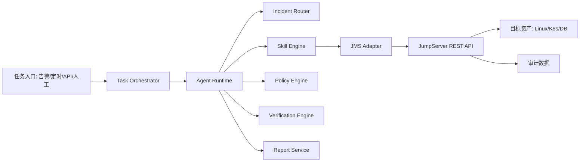

# OpsPaw 系统架构（v0.1）

## 1. 总体架构



## 2. 分层职责

- 接入层：统一任务格式，进入任务队列
- 编排层：管理状态机、重试、超时、人工接管
- Agent 层：任务拆解、Skill 选择、工具调用、结果总结
- 领域层：路由、策略、验证、知识沉淀
- 执行层：JMS Adapter 调用 JumpServer API 执行命令
- 审计层：归档全流程可追溯数据

## 3. 执行状态机

```text
pending -> planning -> observing -> acting -> verifying -> success
pending -> planning -> blocked
pending -> planning -> observing -> acting -> failed
```

## 4. 关键设计原则

- Agent 不直接持有资产密码或私钥
- 所有远程操作必须通过 JumpServer
- 生产环境默认建议模式或受控模式
- 写操作必须模板化与审批化
- 验证结果以业务恢复为准，而非命令退出码

## 5. 部署建议

服务拆分建议：

- `task-orchestrator`：任务生命周期
- `agent-runtime`：Agent 执行核心
- `skill-service`：Skill 注册与执行
- `policy-service`：风控与审批策略
- `jms-adapter`：JumpServer API 封装
- `report-service`：通知与报告

基础设施建议：

- PostgreSQL：任务、Skill、执行元数据
- Redis：队列、缓存、分布式锁
- 对象存储：日志与报告归档

