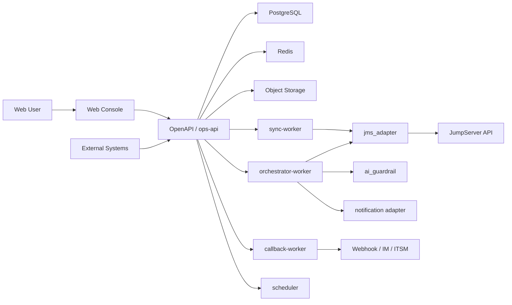
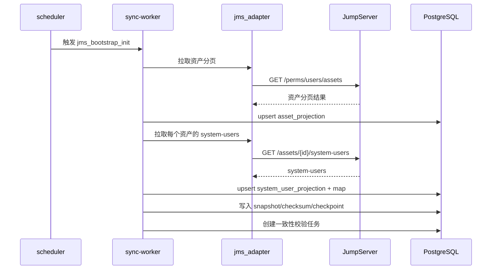
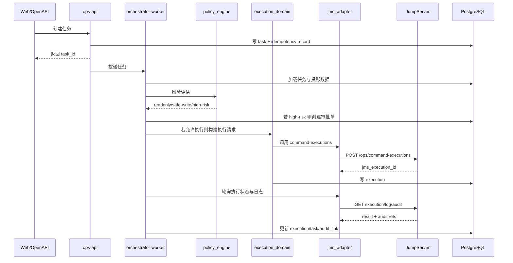

# OpsPaw 详细架构设计（v0.1）

## 1. 设计目标

本文件把 PRD 中的“原则”和 backlog 中的“任务项”落到可实施架构上，解决三个核心问题：

- MVP 应该如何拆分，才能既可控又不把团队拖进过度设计
- 任务、审批、执行、审计、同步这些链路如何真正串起来
- 发生上游故障、数据过期、回调失败、任务风暴时，系统如何稳住

## 2. 架构结论

### 2.1 MVP 架构形态

MVP 推荐采用：

- `模块化单体 API 服务`
- `独立 Worker 进程组`
- `PostgreSQL + Redis + Object Storage`

不建议一开始拆成大量微服务。

原因：

- 当前团队规模偏小，重微服务会把大量时间耗在服务治理、联调、部署复杂度上
- OpsPaw 的核心复杂度不在“服务数量”，而在“状态机、风控、同步、审计一致性”
- 模块化单体更利于先把关键闭环跑通，后续再按负载和边界拆分

### 2.2 运行形态建议

MVP 部署建议至少包含 5 个运行单元：

- `ops-api`：Web + OpenAPI + 配置入口
- `orchestrator-worker`：任务编排、审批推进、执行调度
- `sync-worker`：JumpServer 初始化与增量同步
- `callback-worker`：回调投递、重试、死信处理
- `scheduler`：定时同步、巡检、健康探针、超时扫描

## 3. 逻辑模块边界

建议在同一代码仓库内明确以下模块：

- `gateway`
  - Web 接口
  - OpenAPI 接口
  - 鉴权、限流、幂等入口
- `task_domain`
  - 任务模型
  - 状态机
  - 去重键、取消语义、执行预算
- `scenario_router`
  - 场景匹配
  - 规则路由
  - 模板选择
- `policy_engine`
  - 风险分级
  - 命令黑白名单
  - 冻结窗
  - 审批门控
- `approval_domain`
  - 审批单
  - 超时升级
  - 转交
- `execution_domain`
  - 执行请求
  - 日志聚合
  - 审计关联
  - 人工接管回录
- `sync_domain`
  - 全量初始化
  - 增量同步
  - 快照与校验
  - 数据新鲜度
- `jms_adapter`
  - JumpServer API 封装
  - 认证
  - 接口契约保护
  - 上游健康检查
- `ai_guardrail`
  - 不可信输入清洗
  - 上下文构造
  - 证据卡生成
  - 影子模式
- `audit_observability`
  - 结构化审计日志
  - 指标
  - trace 关联
  - 操作留痕

## 4. 总体运行拓扑

## 5. 关键链路设计

### 5.1 初始化同步链路

关键约束：

- 使用数据库分布式锁避免重复初始化
- 分页同步与系统用户同步都必须支持断点续跑
- 同步写入必须是幂等 upsert

### 5.2 任务执行主链路

关键约束：

- 进入执行前必须做一次主数据新鲜度校验
- 执行范围必须经过预算校验
- 所有关键 ID 必须贯穿：`task_id/execution_id/jms_execution_id/trace_id`

### 5.3 影子模式链路

影子模式与真实执行链路共用大部分逻辑，但在调用 `jms_adapter.execute` 前中断，改为：

- 生成“本来会执行什么”
- 记录“为何被策略允许/拦截”
- 输出证据卡与模拟结果

这能让新模板、新策略先在真实任务流中验证，但不触发真实操作。

## 6. 数据架构

### 6.1 数据分类

PostgreSQL 中的数据分 4 类：

- `projection`
  - `asset_projection`
  - `system_user_projection`
  - `asset_system_user_map`
- `workflow`
  - `task`
  - `task_event`
  - `review_ticket`
  - `execution`
- `governance`
  - `policy_rule`
  - `command_template`
  - `freeze_window`
  - `integration_config`
- `reliability`
  - `idempotency_record`
  - `callback_delivery`
  - `sync_checkpoint`
  - `sync_snapshot`
  - `outbox_event`

### 6.2 数据一致性原则

- JumpServer 是唯一事实源
- projection 表允许覆盖更新，不允许人工直接改事实字段
- workflow 表记录业务状态，不回写 JumpServer 主数据
- 配置表变更必须进入配置审计日志

### 6.3 存储选择边界

- `PostgreSQL`
  - 任务、状态机、审批、配置、审计关联、快照
- `Redis`
  - 队列、短期缓存、限流、分布式锁
- `Object Storage`
  - 较大日志、导出报表、演练/审计附件

## 7. 状态机与一致性控制

### 7.1 任务状态机

建议任务状态：

- `pending`
- `planning`
- `awaiting_approval`
- `ready_to_execute`
- `executing`
- `verifying`
- `success`
- `failed`
- `failed_need_handover`
- `cancelled`

### 7.2 状态迁移原则

- 任务状态只能单向推进
- 取消只能发生在 `pending/planning/awaiting_approval`
- 回调与轮询都只能通过“条件更新”推进状态
- 对同一任务的关键状态修改必须带版本号或乐观锁

### 7.3 幂等设计

必须存在三类幂等：

- API 请求幂等：防止重复创建任务
- 执行幂等：防止同一模板重复落地
- 回调幂等：防止回调重试导致状态抖动

## 8. 安全架构

### 8.1 信任边界

- 用户输入不可信
- 外部回调不可信
- JumpServer 返回的日志文本也不可信
- 只有平台内部结构化状态可被直接信任

### 8.2 核心防护点

- 外部 API：Token/HMAC + 限流 + IP/域名策略
- Web：SSO/OIDC 或企业统一认证
- JumpServer 凭据：只放密钥管理系统
- 日志脱敏：后端统一处理
- Prompt Injection 防护：所有证据文本以“数据”身份进入模型，不以“指令”身份进入模型

### 8.3 审计链

审计必须双轨：

- 业务审计：任务、审批、执行、取消、配置变更
- 技术审计：结构化日志、trace、回调投递、同步事件

缺任一关键关联字段的任务需要自动标红。

## 9. 降级与故障设计

### 9.1 JumpServer 故障

- 健康：允许查询与执行
- 部分异常：禁止新执行，允许查看缓存数据
- 全异常：停止执行、停止审批落地、保留历史查询与告警

### 9.2 数据过期

- `fresh`：允许执行
- `stale`：允许查看，执行前强制刷新
- `expired`：禁止执行，只允许建议模式

### 9.3 任务风暴

- 同类告警任务折叠
- 队列背压
- 每任务执行预算
- 单场景并发上限

### 9.4 回调失败

- 进入重试队列
- 超过阈值进入死信
- UI 可查看死信和重放状态

## 10. MVP 部署建议

### 10.1 本地开发

- Docker Compose
- 一个 `ops-api`
- 一个 `worker`
- PostgreSQL
- Redis
- MinIO

### 10.2 Linux 服务器上的测试/生产

如果当前运行环境是 Linux 服务器，MVP 推荐采用：

- `Nginx` 作为反向代理与静态资源入口
- `Docker Compose` 编排应用容器
- `systemd` 托管 Compose stack 或关键进程

推荐运行单元：

- `nginx`
- `ops-api`
- `orchestrator-worker`
- `sync-worker`
- `callback-worker`
- `scheduler`
- `postgresql`
- `redis`
- `minio`（可选，若日志/报表附件需要对象存储）

### 10.3 何时上 Kubernetes

满足以下条件之一时，再评估迁移到 Kubernetes：

- 已有成熟容器平台，运维团队不希望维护单机/多机 Compose
- 需要多节点扩容与更细粒度弹性伸缩
- 需要更复杂的灰度发布、服务治理、统一观测接入
- Worker 数量和任务规模明显超过 Linux 单机/双机部署边界

## 11. 演进策略

### 11.1 什么时候从模块化单体拆分

满足以下任一条件时再考虑拆服务：

- 同步链路负载显著高于任务链路
- OpenAPI 与 Web 流量显著分离
- 审批/审计域开始有独立扩展需求
- 团队人数增长到需要独立交付边界

### 11.2 优先拆分顺序

- 先拆 `sync-worker`
- 再拆 `jms_adapter` 或 `approval_domain`
- 最后再考虑独立 `api-gateway`

## 12. 需要尽快验证的 Spike

- JumpServer 是否稳定返回执行与审计关联 ID
- `perms/users/assets` 与 `system-users` 的分页/吞吐边界
- `command-executions` 的轮询延迟与日志格式稳定性
- 任务取消与回调重试的竞态处理

## 13. 一句话结论

OpsPaw 的 MVP 最优架构不是“大量服务”，而是：

`一个边界清晰的模块化控制面 + 一组可靠 Worker + 明确的状态机和审计链。`
