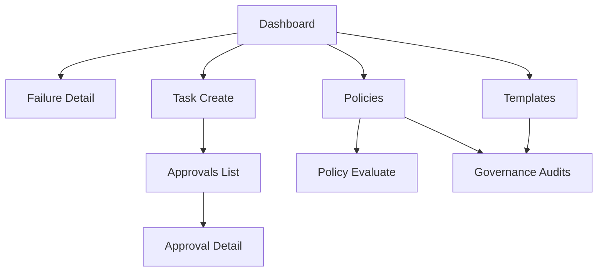

# OpsPaw 前端页面设计规格（v0.1）

## 1. 文档目标

本文用于给前端同学直接开发，覆盖：

- 页面信息架构与路由
- 页面布局与关键组件
- 交互行为与异常处理
- 接口字段映射
- 验收标准

配套文档：

- `16-web-integration-checklist.md`（联调任务清单）
- `05-interface-spec.md`（接口协议）

## 2. 设计原则

- 风险可见：高风险、审批状态、拦截原因必须显著展示。
- 证据优先：看板与失败详情优先展示“为何失败、如何修复”。
- 操作可回退：所有高影响操作走二次确认。
- 性能优先：看板默认走预聚合接口，避免前端拼大计算。

## 3. 信息架构与导航

一级导航建议：

- `总览看板`
- `任务与审批`
- `模板中心`
- `策略治理`
- `治理审计`

路由建议：

- `/dashboard`
- `/dashboard/failures/:failureCode`
- `/tasks/new`
- `/approvals`
- `/approvals/:approvalId`
- `/templates/commands`
- `/policies/blacklist`
- `/policies/evaluate`
- `/governance/audits`

推荐站点结构：

## 4. 页面规格

## 4.1 总览看板 `/dashboard`

页面目标：

- 一屏显示系统健康、失败分型、修复建议入口。

主接口：

- `GET /api/v1/dashboard/overview?hours={h}&source={s}&top_n={n}`

布局区块：

- 顶部过滤栏：`hours`、`source`、刷新按钮
- 告警条：`alerts.level` + `alerts.summary`
- KPI 区：`failure_summary.total_failed`
- 失败分型榜单：`failure_summary.by_failure_code`
- 修复建议卡片区：`remediation_cards`

关键交互：

- 点击失败分型项，跳转 `/dashboard/failures/:failureCode`
- `alerts.level=critical` 时顶部固定红色告警条

状态处理：

- `loading`：骨架屏
- `empty`：暂无失败任务
- `error`：接口失败重试按钮 + trace_id

## 4.2 失败详情 `/dashboard/failures/:failureCode`

页面目标：

- 展示某失败分型的处理建议与近期失败样本。

主接口：

- `GET /api/v1/dashboard/failures/{failure_code}/detail?hours={h}&source={s}&limit={n}`

布局区块：

- 左侧：失败码、严重级别、摘要
- 中部：`recommended_actions`、`verification_steps`
- 底部表格：`recent_failed_tasks`

表格列建议：

- `task_id`
- `source`
- `risk_level`
- `target_asset_id`
- `error_message`
- `updated_at`

关键交互：

- 支持 `hours/source` 二次过滤
- 点击 `task_id` 可跳任务详情页（后续接入）

## 4.3 任务创建 `/tasks/new`

页面目标：

- 提供模板化优先的任务创建入口，并提前给风险解释。

主接口：

- `POST /api/v1/tasks`
- `POST /api/v1/policies/evaluate`
- `GET /api/v1/templates/commands`（模板下拉）

表单字段：

- `command_template_id`（推荐）
- `command`（可选，模板为空时可填）
- `target_asset_id`（必填）
- `run_as_system_user_id`（必填）
- `risk_level`（默认 `readonly`）
- `idempotency_key`（可自动生成）

关键交互：

- 提交前先调 `policies/evaluate`
- 若 `allowed=false`，禁用提交并展示 `block_reason`
- 提交成功后根据返回：
  - `approval_required=true`：跳审批详情
  - 否则跳任务详情

## 4.4 审批列表 `/approvals`

页面目标：

- 按层级查看待审批任务，支持快速处理。

主接口：

- `GET /api/v1/approvals/pending?current_level={n}`
- `GET /api/v1/approvals?status=pending&current_level={n}`

列表列建议：

- `approval_id`
- `task_id`
- `task_source`
- `task_risk_level`
- `current_level/max_level`
- `requested_by`
- `requested_at`
- `expires_at`

关键交互：

- Tab：`L1/L2/...`（按 `current_level`）
- 行内快捷：通过、驳回、升级（可选）

## 4.5 审批详情 `/approvals/:approvalId`

页面目标：

- 完整查看审批上下文与动作流水，执行审批操作。

主接口：

- `GET /api/v1/approvals/{approval_id}`
- `POST /api/v1/approvals/{approval_id}/approve`
- `POST /api/v1/approvals/{approval_id}/reject`
- `POST /api/v1/approvals/{approval_id}/escalate`

布局区块：

- 基础信息卡：状态、层级、超时、来源、风险
- 决策区：通过/驳回/升级按钮 + 原因输入
- 时间线：`actions[]`

动作约束：

- `approved/rejected/expired` 状态禁用操作按钮
- `current_level=max_level` 时禁用升级按钮

## 4.6 模板中心 `/templates/commands`

页面目标：

- 管理命令模板，控制执行入口。

主接口：

- `GET /api/v1/templates/commands`
- `POST /api/v1/templates/commands`
- `PATCH /api/v1/templates/commands/{template_id}`

列表列建议：

- `template_id`
- `name`
- `risk_level`
- `enabled`
- `updated_by`
- `updated_at`

弹窗字段：

- `template_id`（创建时只读唯一）
- `name`
- `description`
- `command`
- `risk_level`
- `enabled`

交互约束：

- 更新前可选调用 `policies/evaluate` 做预检
- 禁止重复 `template_id`

## 4.7 策略治理 `/policies/blacklist` + `/policies/evaluate`

页面目标：

- 可视化黑名单规则，并提供即时策略评估能力。

主接口：

- `GET /api/v1/policies/command-blacklist`
- `POST /api/v1/policies/command-blacklist`
- `PATCH /api/v1/policies/command-blacklist/{rule_id}`
- `POST /api/v1/policies/evaluate`

黑名单列表列建议：

- `pattern`
- `hard_block`
- `enabled`
- `updated_by`
- `updated_at`

策略评估结果区：

- `allowed`
- `block_reason`
- `matched_rules`
- `requested_risk_level`
- `inferred_risk_level`
- `final_risk_level`
- `approval_required`

## 4.8 治理审计 `/governance/audits`

页面目标：

- 展示模板/规则变更留痕，支持追责与复盘。

主接口：

- `GET /api/v1/governance/audits?entity_type=&entity_id=&action=&limit=&offset=`

表格列建议：

- `audit_id`
- `entity_type`
- `entity_id`
- `action`
- `operator_id`
- `source_ip`
- `created_at`

可选抽屉：

- 展开 `detail` JSON

## 5. 组件清单（建议复用）

- `StatusBadge`：任务/审批状态（success/failed/pending/approval_pending）
- `RiskBadge`：readonly/safe-write/high-risk
- `AlertBanner`：ok/warn/critical
- `ActionConfirmModal`：通过/驳回/升级/启停二次确认
- `JsonDrawer`：展示 `matched_rules` 与审计 `detail`
- `TraceHint`：展示 `trace_id`

## 6. 接口字段映射要点

任务创建返回：

- `approval_required` -> 是否跳审批页
- `approval_id` -> 审批详情跳转参数
- `risk_level_final` -> 前端风险标签
- `command_template_id` -> 任务来源标识

审批详情返回：

- `current_level/max_level` -> 分级显示
- `next_escalate_at/expires_at` -> 倒计时
- `actions[]` -> 时间线

策略评估返回：

- `allowed=false` -> 阻止提交
- `matched_rules` -> 高亮命中规则
- `approval_required=true` -> 结果提示“将进入审批”

## 7. 状态与刷新策略

推荐缓存策略（React Query 为例）：

- Dashboard：`staleTime=30s`，手动刷新可强制重取
- Approvals List：`poll 15s`
- Approval Detail：`poll 10s`（仅 pending）
- Templates/Policies：`staleTime=60s`
- Audits：分页按需拉取

并发防抖：

- 审批动作按钮点击后立即 disabled，待接口返回
- 表单提交使用幂等按钮防连点

## 8. 异常与边界处理

- `POLICY_BLOCKED`：展示命中 pattern 与拦截原因
- `APPROVAL_STATE_CONFLICT`：提示“状态已变化，请刷新”
- `404 NOT_FOUND`：页面级空态 + 返回列表
- `429`：展示“请求过快，请稍后重试”
- 网络失败：统一重试按钮 + 最近一次 trace_id

## 9. 响应式与可用性

断点建议：

- Desktop：`>=1200`
- Tablet：`768-1199`
- Mobile：`<768`

移动端策略：

- 看板卡片单列
- 表格转卡片
- 审批动作固定底部按钮区

可访问性：

- 关键按钮支持键盘焦点
- 告警颜色配文本，不只靠颜色
- 时间字段显示本地时区

## 10. 前端验收清单

- 看板接口联调通过，能展示告警等级与修复卡片
- 失败详情能展示建议与失败样本
- 模板增改查可用，状态切换后列表一致
- 黑名单增改查可用，策略评估能正确拦截
- 高风险任务创建后进入审批流
- 审批通过/驳回/升级动作闭环可验证
- 治理审计可查到模板与黑名单变更动作

## 11. 开发建议顺序

1. Dashboard 与 Failure Detail  
2. Template Center 与 Policy Evaluate  
3. Approvals（列表 + 详情 + 操作）  
4. Governance Audits  
5. Task Create 串联跳转闭环  
