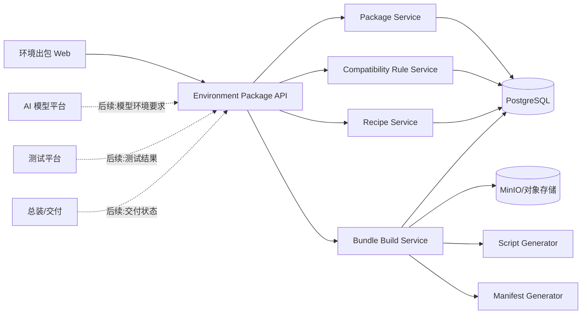
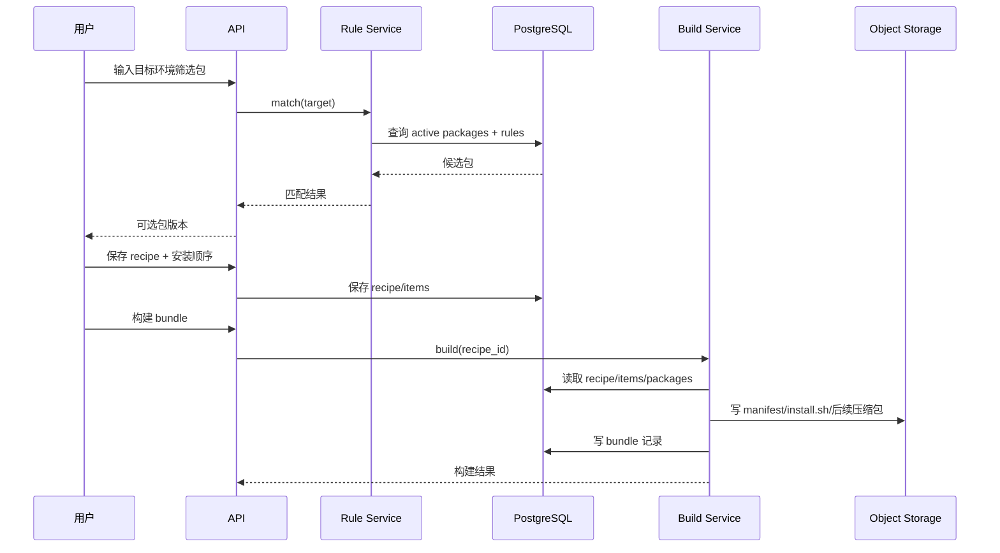
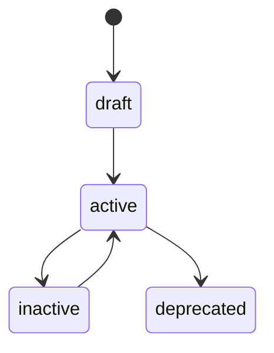
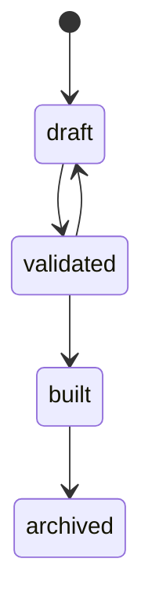
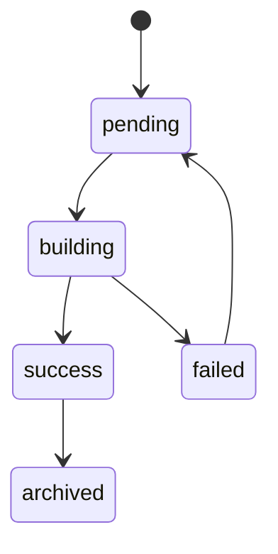

# AI 推理环境安装包编排平台架构设计文档

## 1. 架构目标

当前架构目标不是先做设备实施闭环，而是先支撑环境安装包工程化管理：

- 安装包资产可管理。
- 适配规则可配置。
- 包依赖/冲突可校验。
- 组合方案可保存。
- manifest 和总安装脚本可生成。
- 构建产物可追溯。
- 后续可对接模型平台、测试平台、总装交付。

## 2. 总体架构



## 3. 模块职责

### 3.1 Package Service

负责：

- 安装包元数据管理。
- 包版本状态管理。
- 安装脚本片段管理。
- 校验脚本片段管理。
- 文件 URI 和 checksum 管理。

### 3.2 Compatibility Rule Service

负责：

- 包适配条件管理。
- 根据目标环境筛选可用包。
- 匹配结果解释。

一期规则：字段等值匹配 + 空值通配。

后续规则：版本范围、表达式、厂商兼容矩阵。

### 3.3 Dependency Service

负责：

- requires/conflicts/recommends/replaces 关系管理。
- recipe 保存前依赖校验。
- recipe 保存前冲突校验。
- 推荐安装顺序计算。

一期不做复杂求解，只做显式关系校验。

### 3.4 Recipe Service

负责：

- 目标环境条件保存。
- 选包结果保存。
- 安装顺序保存。
- recipe 状态流转。
- recipe 复制和版本化，后续。

### 3.5 Bundle Build Service

负责：

- 基于 recipe 生成 manifest。
- 基于 recipe 生成总安装脚本。
- 汇总包文件引用。
- 生成 bundle 构建记录。
- 后续扩展为真实 tar.gz/zip 打包。

### 3.6 Manifest Generator

负责输出标准 manifest JSON。

manifest 是环境包可交付和可追溯的核心文件。

### 3.7 Script Generator

负责输出总安装脚本。

一期生成 shell 脚本，后续可支持 PowerShell、Ansible Playbook 等格式。

## 4. 核心链路

### 4.1 安装包入库链路

```text
创建安装包
  -> 填写版本和类型
  -> 配置文件 URI/checksum
  -> 配置安装脚本片段
  -> 配置验证脚本
  -> 配置适配规则
  -> 配置依赖/冲突
  -> 启用
```

### 4.2 组合方案链路

```text
输入目标环境条件
  -> 匹配可用安装包版本
  -> 按类型展示候选包
  -> 用户选择包
  -> 用户设置安装顺序
  -> 校验依赖/冲突
  -> 保存 recipe
```

### 4.3 出包链路

```text
选择 recipe
  -> 读取包清单和顺序
  -> 生成 manifest
  -> 生成 install.sh
  -> 记录 bundle
  -> 返回产物 URI 或内容
```

## 5. 数据流



## 6. 状态机

### 6.1 安装包状态



### 6.2 Recipe 状态



### 6.3 Bundle 状态



## 7. 与其他系统关系

### 7.1 与模型平台

当前不强依赖模型平台。

后续模型平台可以：

- 传入模型环境要求。
- 关联 recipe 或 bundle。
- 查询某模型推荐环境包。

### 7.2 与测试平台

当前不做完整测试管理。

后续测试平台可以：

- 拉取 bundle。
- 回写测试结果。
- 标记 bundle 是否可交付。

### 7.3 与总装/交付

当前不做完整交接单。

后续总装可以：

- 下载已测试 bundle。
- 查看 manifest。
- 标记接收状态。

### 7.4 与 JumpServer/AWX/Rundeck

当前不做远程安装。

后续可用生成的 bundle 和 install.sh 作为受控执行输入。

## 8. 部署建议

复用现有 OpsPaw 基础设施：

- FastAPI：API 服务。
- PostgreSQL：元数据和构建记录。
- MinIO：安装包、manifest、install.sh、后续大包。
- Redis：后续异步构建队列。
- React + Ant Design：Web 管理界面。

## 9. 安全与审计

- 安装脚本属于高风险资产，创建和修改必须记录审计。
- 包文件必须记录 checksum。
- bundle 必须能追溯到 recipe 和 package version。
- 后续执行安装时，必须通过受控执行系统，不直接保存服务器凭证。
- 脚本安全扫描、审批和签名作为后续增强。
