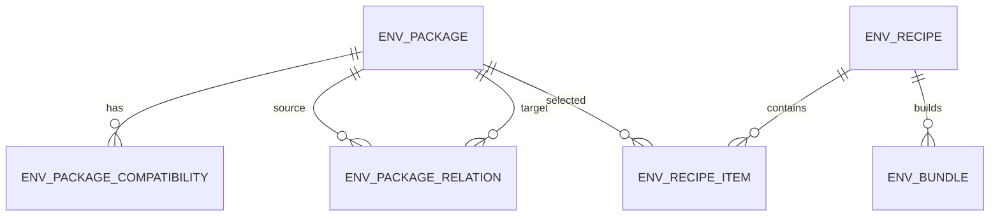

# AI 推理环境安装包编排平台数据库设计文档

## 1. 设计目标

当前数据库优先支撑：

- 安装包资产管理。
- 包适配条件管理。
- 包依赖/冲突管理。
- 环境组合 recipe 管理。
- 环境 bundle 构建记录。

设备实施记录、测试结果、总装交接作为后续扩展，不是当前核心表。

## 2. ER 关系



## 3. 表设计

## 3.1 env_package 安装包表

用途：记录一个可复用安装包版本。

| 字段 | 类型 | 说明 |
|---|---|---|
| id | varchar(36) | 主键 UUID |
| package_code | varchar(64) | 包编码，同类包稳定标识 |
| name | varchar(128) | 包名称 |
| package_type | varchar(64) | driver/runtime/framework/inference_server 等 |
| version | varchar(128) | 包版本 |
| file_uri | varchar(1024) | 包文件地址 |
| file_name | varchar(255) | 文件名 |
| checksum_type | varchar(32) | sha256/md5 |
| checksum | varchar(255) | 文件校验值 |
| size_bytes | bigint | 文件大小，可为空 |
| install_script | text | 安装脚本片段 |
| uninstall_script | text | 卸载脚本片段，可为空 |
| install_script | text | 安装脚本，必填 |
| verify_script | text | 安装后成功检查脚本，必填 |
| precheck_script/check_script | text | 历史兼容字段，可为空，不参与交付包默认执行 |
| verify_script | text | 安装后验证脚本，可为空 |
| requires_root | boolean | 是否需要 root |
| requires_reboot | boolean | 是否需要重启 |
| offline_supported | boolean | 是否支持离线安装 |
| status | varchar(32) | draft/active/inactive/deprecated |
| description | varchar(2048) | 描述 |
| created_by | varchar(64) | 创建人 |
| updated_by | varchar(64) | 更新人 |
| created_at | timestamptz | 创建时间 |
| updated_at | timestamptz | 更新时间 |

建议唯一约束：

- `(package_code, version)` 唯一。

## 3.2 env_package_compatibility 适配条件表

用途：描述某个安装包版本适配哪些目标环境。

| 字段 | 类型 | 说明 |
|---|---|---|
| id | varchar(36) | 主键 UUID |
| package_id | varchar(36) | 安装包 ID |
| hardware_vendor | varchar(128) | 硬件厂商，空表示不限 |
| cpu_arch | varchar(64) | x86_64/aarch64/arm64 等，空表示不限 |
| os_type | varchar(64) | ubuntu/centos/kylin/uos/windows 等 |
| os_version | varchar(128) | 系统版本，空表示不限 |
| accelerator_vendor | varchar(64) | NVIDIA/Ascend/AMD/Cambricon 等 |
| accelerator_model | varchar(128) | A10/A30/Atlas 等 |
| driver_version_min | varchar(128) | 最低驱动版本，可为空 |
| driver_version_max | varchar(128) | 最高驱动版本，可为空 |
| runtime_name | varchar(128) | CUDA/CANN/ROCm 等 |
| runtime_version_min | varchar(128) | 最低运行时版本，可为空 |
| runtime_version_max | varchar(128) | 最高运行时版本，可为空 |
| python_version_min | varchar(64) | 最低 Python 版本，可为空 |
| python_version_max | varchar(64) | 最高 Python 版本，可为空 |
| kernel_version | varchar(128) | 内核版本，可为空 |
| match_mode | varchar(32) | exact/compatible |
| description | varchar(1024) | 说明 |
| created_at | timestamptz | 创建时间 |
| updated_at | timestamptz | 更新时间 |

一期匹配策略：

- 空字段代表通配。
- 非空字段优先做等值匹配。
- version_min/version_max 一期可先存储，后续再启用范围比较。

## 3.3 env_package_relation 包关系表

用途：描述包之间的依赖、冲突、推荐、替代关系。

| 字段 | 类型 | 说明 |
|---|---|---|
| id | varchar(36) | 主键 UUID |
| source_package_id | varchar(36) | 源包 ID |
| target_package_id | varchar(36) | 目标包 ID |
| relation_type | varchar(32) | requires/conflicts/recommends/replaces |
| description | varchar(1024) | 说明 |
| created_at | timestamptz | 创建时间 |
| updated_at | timestamptz | 更新时间 |

语义：

- `A requires B`：选择 A 时必须选择 B，且 B 应在 A 前安装。
- `A conflicts B`：A 和 B 不能同时在 recipe 中出现。
- `A recommends B`：选择 A 时推荐选择 B，但不阻塞。
- `A replaces B`：A 替代 B。

## 3.4 env_recipe 环境组合方案表

用途：记录一次目标环境下的选包方案。

| 字段 | 类型 | 说明 |
|---|---|---|
| id | varchar(36) | 主键 UUID |
| recipe_code | varchar(64) | recipe 编号，唯一 |
| name | varchar(128) | 名称 |
| version | varchar(64) | 版本 |
| target_hardware_vendor | varchar(128) | 目标硬件厂商 |
| target_cpu_arch | varchar(64) | 目标 CPU 架构 |
| target_os_type | varchar(64) | 目标 OS |
| target_os_version | varchar(128) | 目标 OS 版本 |
| target_accelerator_vendor | varchar(64) | 目标推理卡厂商 |
| target_accelerator_model | varchar(128) | 目标推理卡型号 |
| target_runtime_name | varchar(128) | 目标运行时 |
| target_runtime_version | varchar(128) | 目标运行时版本 |
| target_framework | varchar(128) | 目标框架 |
| target_inference_server | varchar(128) | 目标推理服务 |
| status | varchar(32) | draft/validated/built/archived |
| validation_summary | text | 依赖/冲突校验结果 |
| description | varchar(2048) | 描述 |
| created_by | varchar(64) | 创建人 |
| updated_by | varchar(64) | 更新人 |
| created_at | timestamptz | 创建时间 |
| updated_at | timestamptz | 更新时间 |

建议唯一约束：

- `recipe_code` 唯一。

## 3.5 env_recipe_item 组合方案明细表

用途：记录 recipe 中选中的安装包和安装顺序。

| 字段 | 类型 | 说明 |
|---|---|---|
| id | varchar(36) | 主键 UUID |
| recipe_id | varchar(36) | recipe ID |
| package_id | varchar(36) | 安装包 ID |
| install_order | integer | 安装顺序，从小到大 |
| enabled | boolean | 是否启用 |
| custom_install_args | varchar(2048) | 自定义安装参数，可为空 |
| notes | varchar(1024) | 备注 |
| created_at | timestamptz | 创建时间 |
| updated_at | timestamptz | 更新时间 |

建议约束：

- `(recipe_id, package_id)` 唯一。
- `(recipe_id, install_order)` 可唯一，也可允许并列后由二级排序处理。

## 3.6 env_bundle 构建产物表

用途：记录基于 recipe 生成的大环境包。

| 字段 | 类型 | 说明 |
|---|---|---|
| id | varchar(36) | 主键 UUID |
| bundle_code | varchar(64) | bundle 编号，唯一 |
| recipe_id | varchar(36) | recipe ID |
| name | varchar(128) | bundle 名称 |
| version | varchar(64) | bundle 版本 |
| status | varchar(32) | pending/building/success/failed/archived |
| manifest_json | text | manifest 内容 |
| install_script | text | 总安装脚本内容 |
| manifest_uri | varchar(1024) | manifest 文件 URI |
| install_script_uri | varchar(1024) | install.sh URI |
| bundle_uri | varchar(1024) | 大包 URI |
| build_log | text | 构建日志 |
| failure_reason | varchar(2048) | 失败原因 |
| built_by | varchar(64) | 构建人 |
| built_at | timestamptz | 构建时间 |
| test_status | varchar(32) | untested/passed/failed，可选 |
| delivery_status | varchar(32) | pending/delivered/accepted，可选 |
| created_at | timestamptz | 创建时间 |
| updated_at | timestamptz | 更新时间 |

建议唯一约束：

- `bundle_code` 唯一。

## 4. 后续扩展表

当前暂不作为 MVP：

- `inference_device`：设备台账。
- `environment_implementation`：设备实施记录。
- `environment_handover`：交接单。
- `env_bundle_test_result`：测试结果明细。
- `env_package_security_scan`：脚本安全扫描记录。
- `env_build_task`：异步构建任务。

## 5. 索引建议

- `env_package(package_code, version)` 唯一索引。
- `env_package(package_type, status)` 普通索引。
- `env_package_compatibility(package_id)` 普通索引。
- `env_package_compatibility(cpu_arch, os_type, accelerator_vendor, accelerator_model)` 普通索引。
- `env_package_relation(source_package_id)` 普通索引。
- `env_package_relation(target_package_id)` 普通索引。
- `env_recipe(recipe_code)` 唯一索引。
- `env_recipe(status)` 普通索引。
- `env_recipe_item(recipe_id, install_order)` 普通索引。
- `env_bundle(bundle_code)` 唯一索引。
- `env_bundle(recipe_id)` 普通索引。
- `env_bundle(status)` 普通索引。

## 6. manifest JSON 建议结构

```json
{
  "bundle": {
    "code": "bundle-yolo-a10-ubuntu2204-v1",
    "name": "YOLO A10 Ubuntu 22.04 Environment",
    "version": "1.0",
    "built_at": "2026-06-27T12:00:00Z"
  },
  "target": {
    "cpu_arch": "x86_64",
    "os_type": "ubuntu",
    "os_version": "22.04",
    "accelerator_vendor": "NVIDIA",
    "accelerator_model": "A10"
  },
  "packages": [
    {
      "order": 10,
      "package_code": "nvidia-driver",
      "version": "535.183",
      "file": "packages/10-nvidia-driver/driver.run",
      "checksum": "sha256:...",
      "requires_root": true,
      "requires_reboot": true
    }
  ]
}
```

## 7. 总安装脚本生成规则

总脚本根据 `env_recipe_item.install_order` 生成。

一期规则：

- 使用 bash。
- `set -euo pipefail`。
- 每个包一个执行阶段。
- 调用子包 install 脚本。
- 子包失败则总脚本失败。
- 输出安装日志。
- 最后输出完成提示和重启提示。
